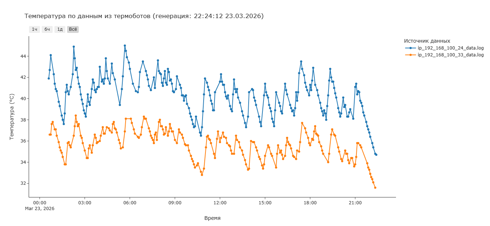

# Thermobot‑Data2Graphs

Репозиторий о том, как автор использует устройства **Thermobot** — Wi‑Fi‑термометры на ESP8266 с датчиком Dallas DS18B20 от [42юнита.ру](https://www.42unita.ru) — и превращает их показания в историю и графики. Путь автора: заводская прошивка → сбор логов по HTTP → графики Plotly → интеграция с Home Assistant → собственная прошивка ESPHome.

> **Обратите внимание.** Автор исходит из того, что описанные устройства больше не будут доступны к покупке, и материал представляет интерес прежде всего для действующих владельцев Thermobot.


*Рисунок 1. График температур подачи и обратки в Home Assistant после перехода на ESPHome.*

## Содержание

- [Зачем этот репозиторий](#зачем-этот-репозиторий)
- [Как автор использует устройство](#как-автор-использует-устройство)
- [Три этапа проекта](#три-этапа-проекта)
- [Структура репозитория](#структура-репозитория)
- [Аппаратная часть](#аппаратная-часть)
- [Быстрый старт: ESPHome](#быстрый-старт-esphome)
- [Настройка в Home Assistant](#настройка-в-home-assistant)
- [Альтернатива: REST API](#альтернатива-rest-api)
- [Архив: сбор логов и графики](#архив-сбор-логов-и-графики)
- [Ограничения и важные замечания](#ограничения-и-важные-замечания)
- [Документация](#документация)
- [Лицензия](#лицензия)

## Зачем этот репозиторий

Thermobot умеет измерять температуру и отдавать её по HTTP (заводская прошивка — `GET /read`), но не даёт удобной истории и управления. В репозитории собраны три последовательных решения этой задачи, каждое доведено до рабочего состояния:

- **архивный конвейер** — опрос нескольких устройств по HTTP, текстовые логи, Plotly‑дашборд на GNU/Linux;
- **REST API** — получение температуры в Home Assistant без перепрошивки;
- **ESPHome** — собственная прошивка с автоматическим обнаружением, калибровкой, аварийными порогами и OTA. Это текущий и рекомендуемый путь.

Материал будет полезен, если вы:

- владелец Thermobot и хотите видеть показания в Home Assistant;
- хотите заменить заводскую прошивку на ESPHome, сохранив функции устройства;
- ищете рабочий пример сбора и визуализации температуры на домашнем сервере.

Скрипты архивного конвейера эксплуатировались на артикулах **Thermobot‑2.2** и **Thermobot‑2 Mini**; ESPHome‑прошивка проверена на **Thermobot‑2 Mini**.

## Как автор использует устройство

### Отопительный контур: подача и обратка

Основной текущий сценарий — контроль температурного контура отопления. На **Thermobot‑2 Mini** с прошивкой ESPHome работают два датчика DS18B20 на одной 1‑Wire‑шине: штатный и добавленный параллельно второй. Первый измеряет **подачу**, второй — **обратку**.

- Устройство называется `HeatFlow Dual`, данные уходят в Home Assistant по ESPHome API каждые **30 секунд** (push, без опроса).
- В Home Assistant видны обе температуры, разница подача−обратка, уровень Wi‑Fi, время работы, состояние аварии, отказ датчика и сервисные кнопки.
- Пороги аварии по умолчанию — **5 °C** и **90 °C** для каждого датчика: при выходе любого датчика за свой диапазон устройство мигает светодиодом и повторяет звуковой сигнал.
- Калибровка задаётся прямо из Home Assistant; для подачи по умолчанию оставлено смещение **+3,5 °C**, унаследованное от старого жёстко заданного фильтра.
- Светодиод, зуммер (громкость, частота, длительность) и тестовый сигнал также управляются из Home Assistant; локальный сигнал можно подтвердить кнопкой `Acknowledge alarm` или физической кнопкой.
- Обновление прошивки — по воздуху, без разборки устройства.

Именно этот вариант показан на рисунке 1: две линии температур в Home Assistant после перехода на ESPHome.

### Серверная: несколько датчиков и архив показаний

До Home Assistant устройство использовалось для мониторинга температуры в серверной (или датацентре) **множеством датчиков** с сохранением истории на дашборде. С заводской прошивкой автор:

1. находил IP‑адреса устройств по MAC‑адресам;
2. опрашивал каждый Thermobot по HTTP каждые **4 минуты**;
3. складывал показания в текстовые логи;
4. раз в **20 минут** пересобирал интерактивный Plotly‑дашборд;
5. хранил ротированные логи **30 дней**.

Этот конвейер остался в каталогах [`thermobot_logs/`](thermobot_logs) и [`thermobot_graf/`](thermobot_graf) как рабочий архив — он не требует Home Assistant, но требует GNU/Linux, `nmap`, `curl`, `cron` и Python 3.

### Почему в итоге ESPHome

- Устройство больше не зависит от смены IP: mDNS‑имя `heatflow.local` и стабильные `unique_id`.
- Home Assistant обнаруживает устройство автоматически, вручную вводить IP не нужно.
- Данные приходят push‑ом каждые 30 секунд, а не опросом раз в 90 секунд.
- Калибровка, пороги, звук и светодиод настраиваются из Home Assistant и переживают перезагрузку.
- Прошивка обновляется по OTA.

## Три этапа проекта

| Этап | Прошивка | Как собираются данные | Визуализация | Каталог | Статус |
|---|---|---|---|---|---|
| 1. До Home Assistant | заводская | `curl` по HTTP, cron каждые 4 мин | Plotly HTML, systemd‑таймер | [`thermobot_logs/`](thermobot_logs), [`thermobot_graf/`](thermobot_graf) | архив, работает |
| 2. Home Assistant + REST | заводская | REST‑датчики Home Assistant, опрос 90 с | история Home Assistant | [`thermobot_hass/RestAPI/`](thermobot_hass/RestAPI) | legacy |
| 3. Home Assistant + ESPHome | ESPHome, `heatflow.yaml` | ESPHome API, push 30 с | Home Assistant + web‑интерфейс | [`thermobot_hass/esphome/`](thermobot_hass/esphome) | рекомендуется |

Подробное обоснование выбора и сравнительная таблица — в [обзоре интеграции](thermobot_hass/README.MD).

## Структура репозитория

```text
thermobot-data2graphs/
├── README.md                        # этот файл: обзор и путь автора
├── LICENSE                          # MIT
├── .gitignore                       # секреты и артефакты сборки
├── thermobot_hass/                  # интеграция с Home Assistant
│   ├── README.MD                    # сравнение ESPHome и REST API
│   ├── esphome/
│   │   ├── README.MD                # подробная инструкция по прошивке
│   │   ├── heatflow.yaml            # рабочая прошивка (ESPHome 2026.9.1)
│   │   ├── secrets.example.yaml     # шаблон secrets.yaml
│   │   ├── thermobot.yaml           # реверс заводской прошивки, справочно
│   │   └── images/                  # график, схема пинов, фото подключения
│   └── RestAPI/
│       ├── README.md                # инструкция по REST/MQTT
│       └── configuration.yaml       # фрагмент configuration.yaml
├── thermobot_graf/                  # архив: построение графиков
│   ├── plot_temperatures.py         # логи → Plotly HTML
│   ├── requirements.txt             # pandas, plotly и зависимости
│   ├── thermobot.service            # запуск скрипта
│   ├── thermobot.timer              # запуск каждые 20 минут
│   ├── thermobot-logrotare.script   # правила logrotate
│   ├── newplot.png                  # пример графика
│   ├── пример файла/                # готовый HTML-дашборд
│   └── инструкции и описания/       # описания скриптов и установки
└── thermobot_logs/                  # архив: сбор данных
    ├── check_mac_ip.sh              # MAC → IP, проверка HTTP
    ├── fetch_ip_data.sh             # опрос /read и запись логов
    ├── cron.cfg                     # задача cron каждые 4 минуты
    ├── settings.txt                 # MAC_LIST и IP_LIST
    ├── settings_example.txt         # пример заполнения
    └── about check_mac_ip.md        # краткое описание
```

**С чего начать:**

| Задача | Файл |
|---|---|
| Прошить Thermobot‑2 Mini под Home Assistant | [`thermobot_hass/esphome/heatflow.yaml`](thermobot_hass/esphome/heatflow.yaml) |
| Понять, как устроена прошивка | [`thermobot_hass/esphome/README.MD`](thermobot_hass/esphome/README.MD) |
| Оставить заводскую прошивку и подключить её к HA | [`thermobot_hass/RestAPI/configuration.yaml`](thermobot_hass/RestAPI/configuration.yaml) |
| Собрать архивный конвейер | [`thermobot_logs/fetch_ip_data.sh`](thermobot_logs/fetch_ip_data.sh) + [`thermobot_graf/plot_temperatures.py`](thermobot_graf/plot_temperatures.py) |
| Восстановить логику заводской прошивки | [`thermobot_hass/esphome/thermobot.yaml`](thermobot_hass/esphome/thermobot.yaml) |

## Аппаратная часть

- **Плата:** Thermobot‑2 Mini, модуль **ESP8266MOD**, 4 МБ flash. Производитель — [42unita.ru](https://www.42unita.ru).
- **Датчики:** Dallas **DS18B20** (1‑Wire). В оригинале один, в проекте параллельно добавлен второй (подача/обратка). Адреса датчиков уникальны.
- **Индикация:** светодиод с инверсной логикой, пассивный зуммер.
- **Прошивка:** через адаптер **USB‑UART на CH340G**, питание **только 3,3 В**. USB Type‑C на плате используется только для питания уже прошитого устройства.
- **Wi‑Fi:** ESP8266 работает только в диапазоне **2,4 ГГц**.

| Сигнал | GPIO | Комментарий |
|---|---|---|
| DS18B20 (1‑Wire data) | **GPIO0** | strapping‑пин; подтяжка 4,7 кОм к 3,3 В |
| Светодиод | **GPIO2** | инверсная логика; при загрузке должен быть HIGH |
| Зуммер (PWM) | **GPIO12** | в оригинале `tone(12, 3000, 100)` |
| Кнопка | **GPIO14** | `INPUT_PULLUP`, активный низкий уровень, опционально |
| TM1637 CLK / DIO | **GPIO4 / GPIO5** | только в `thermobot.yaml` (заводская прошивка) |


*Рисунок 2. Пины платы Thermobot‑2 Mini, используемые для прошивки.*

## Быстрый старт: ESPHome

Понадобится: Thermobot‑2 Mini, Home Assistant с интеграцией **ESPHome**, пакет **ESPHome 2026.9.1** (на нём конфигурация проверена; после тестирования рекомендуется 2026.10+), адаптер USB‑UART, `esptool`, сеть 2,4 ГГц и подтяжка 4,7 кОм на линии данных (на плате или внешняя).

### Шаг 1. Секреты

Скопируйте шаблон и заполните его:

```bash
cd thermobot_hass/esphome
cp secrets.example.yaml secrets.yaml
nano secrets.yaml
```

```yaml
wifi_0f: "ssid_вашей_сети_2.4GHz"      # именно этот ключ используется в heatflow.yaml
wifi_password: "пароль_вашей_сети_2.4GHz"
web_server_pass: "пароль_для_веб_интерфейса"
api_key: "api_ключ_для_home_assistant" # сгенерировать: esphome generate-encryption-key
```

Файл содержит пароли и **не должен попадать в git**: `secrets.yaml` уже исключён в [`.gitignore`](.gitignore).

### Шаг 2. Адреса DS18B20

В `heatflow.yaml` замените заведомо неверные адреса на реальные:

```yaml
addr_supply: "0x00000000b34d1328"   # требует замены
addr_return: "0xb7000000cb2eb328"   # требует замены
```

Как узнать адреса:

1. Временно укажите оба адреса как `0x0000000000000000` и включите подробный лог: в `logger` задайте `level: DEBUG`, а для логов по USB — `baud_rate: 115200` (в рабочей конфигурации стоит `WARN` и `baud_rate: 0`).
2. Соберите и прошейте устройство, откройте логи в ESPHome Dashboard (или последовательный порт).
3. Найдите в логе перечень найденных 1‑Wire‑устройств — строки с адресами вида `0x...`.
4. Подставьте адреса в `addr_supply` / `addr_return`, верните прежние настройки `logger` и прошейте ещё раз.

Пока адреса не заменены, температуры в Home Assistant не будет, а примерно через 90 секунд появится `Temperature sensor fault`.

### Шаг 3. Сборка

```bash
cd thermobot_hass/esphome
esphome config heatflow.yaml     # проверка синтаксиса и секретов
esphome compile heatflow.yaml
```

Готовый `firmware.bin` появится в каталоге сборки рядом с конфигурацией:
`thermobot_hass/esphome/.esphome/build/heatflow/.pioenvs/heatflow/firmware.bin`.

### Шаг 4. Первая прошивка по USB‑UART


*Рисунок 3. Подключение платы к адаптеру USB‑UART для первой прошивки.*

1. Подключите плату к адаптеру **по питанию 3,3 В** (не 5 В).
2. Войдите в режим загрузчика: при подключении платы замкните **GND→GPIO0**, затем **GND→RST**, отпустите RST, отпустите GPIO0.
3. Прошейте, заменив `COM4` на свой порт и указав путь к `firmware.bin`:

```powershell
esptool --chip esp8266 --port COM4 --baud 115200 write-flash --flash-mode qio --flash-size 4MB 0x00000 firmware.bin
```

Успешная прошивка заканчивается строками `Hash of data verified.` и `Hard resetting via RTS pin...`.

### Шаг 5. Wi‑Fi и Home Assistant

После загрузки устройство поднимает Wi‑Fi. Если сеть недоступна, открывается точка доступа **`HeatFlow Dual`** с паролем из `web_server_pass` и captive portal.

- Web‑интерфейс: [http://heatflow.local](http://heatflow.local), порт 80, пользователь `heatflow`, пароль `web_server_pass` (digest‑авторизация).
- Home Assistant обычно обнаруживает устройство автоматически. Если нет: **«Настройки» → «Устройства и службы» → «Добавить интеграцию» → ESPHome**, хост `heatflow.local`, порт `6053`, ключ шифрования из `secrets.yaml`.
- Если mDNS не работает, возьмите IP‑адрес устройства из списка клиентов роутера.

### Обновление прошивки

После первой прошивки обновления идут по воздуху:

- **ESPHome CLI:** `esphome run thermobot_hass/esphome/heatflow.yaml`;
- **web‑интерфейс устройства:** раздел OTA на [heatflow.local](http://heatflow.local);
- **Home Assistant:** карточка устройства → «Обновить».

Конфигурация проверена на **ESPHome 2026.9.1** и содержит `min_version: "2026.9.1"`. После тестирования рекомендуется перейти на **2026.10+**: там появились нативные сборки ESP8266 и сжатые OTA‑обновления. Первая сборка после перехода будет чистой; при проблемах можно временно указать `toolchain: platformio` в секции `esp8266:`.

## Настройка в Home Assistant

Имена сущностей зависят от `friendly_name` и `devicename`; ниже — значения из `heatflow.yaml`.

| Сущность | Тип | Категория | Назначение | По умолчанию |
|---|---|---|---|---|
| `Supply temperature` | sensor | — | температура подачи, °C | калибровка +3,5 °C |
| `Return temperature` | sensor | — | температура обратки, °C | калибровка 0 °C |
| `Delta temperature` | sensor | — | разница «подача − обратка», °C | — |
| `WiFi Signal` | sensor | diagnostic | уровень Wi‑Fi, dBm | обновление 60 с |
| `Uptime` | sensor | diagnostic | время работы | обновление 300 с |
| `Temperature alarm` | binary_sensor (`problem`) | — | любой датчик вне своих порогов | 5…90 °C для каждого |
| `Temperature sensor fault` | binary_sensor (`problem`) | — | DS18B20 не читается (`NaN`) | срабатывает через 90 с |
| `Physical button` | binary_sensor | diagnostic, скрыт | кнопка GPIO14; короткий клик сбрасывает сигнал | — |
| `Status` | binary_sensor | diagnostic | устройство на связи с API | — |
| `Supply calibration` | number | config | смещение подачи, −10…+10 °C, шаг 0,1 | +3,5 °C |
| `Return calibration` | number | config | смещение обратки, −10…+10 °C, шаг 0,1 | 0 °C |
| `Supply alarm low` | number | config | нижний порог подачи | 5 °C |
| `Supply alarm high` | number | config | верхний порог подачи | 90 °C |
| `Return alarm low` | number | config | нижний порог обратки | 5 °C |
| `Return alarm high` | number | config | верхний порог обратки | 90 °C |
| `Alarm repeat interval` | number | config | период повторения сигнала | 60 с |
| `Sound volume` | number | config | громкость зуммера, 0–100 % | 100 % |
| `Sound frequency` | number | config | частота, 500–5000 Гц | 3000 Гц |
| `Sound duration` | number | config | длительность, 20–2000 мс | 100 мс |
| `LED` | switch | config | светодиод индикации | — |
| `Sound` | switch | config | общий выключатель звука | включён |
| `Beep test` | button | diagnostic | тестовый сигнал | — |
| `Acknowledge alarm` | button | diagnostic | замолчать до нормализации температуры | — |
| `Restart` | button | diagnostic | перезагрузка устройства | — |
| `Safe mode` | button | diagnostic | перезагрузка в safe mode | — |
| `IP Address` / `SSID` / `BSSID` | text_sensor | diagnostic | сетевые данные | — |
| `ESPHome Version` | text_sensor | diagnostic, скрыт | версия прошивки | — |

`config` и `diagnostic` — это категории сущностей Home Assistant: они убирают настройки и служебные данные из основного списка. Скрытые (`Physical button`, `ESPHome Version`) можно включить вручную в карточке устройства.

### Диагностика и сервис

`Status` показывает, что устройство на связи с API; `IP Address`, `SSID`, `BSSID` помогают разобраться с сетью. Кнопки `Restart` и `Safe mode` позволяют перезагрузить устройство удалённо, в том числе в безопасном режиме, если неудачная прошивка мешает OTA. `Physical button` по умолчанию скрыта в HA, но её короткий клик продолжает работать локально и сбрасывает звуковой сигнал.

### Калибровка

Калибровка — это смещение, которое прибавляется к «сырому» показанию: `value = raw + calibration`. Новое значение применяется со следующего измерения (интервал 30 с). Смещение для подачи **+3,5 °C** оставлено намеренно: раньше этот сдвиг был жёстко зашит в фильтр датчика.

### Авария по температуре

Пороги задаются отдельно для каждого датчика:

- подача — `[Supply alarm low, Supply alarm high]`;
- обратка — `[Return alarm low, Return alarm high]`.

`Temperature alarm` включается, если любой **доступный** датчик вышел за свой диапазон. По умолчанию у обоих датчиков 5…90 °C; для обратки верхний порог можно снизить (например, до 70 °C), чтобы раньше заметить проблему циркуляции. Пока авария активна, скрипт `alarm_loop` мигает светодиодом и пищит с периодом `Alarm repeat interval`.

Если устройство загрузилось, уже находясь в аварии, сигнал всё равно запустится: у датчика включён `trigger_on_initial_state`, а `delayed_on: 5s` защищает от дребезга. После нормализации температуры сигнал прекращается после 30‑секундного подтверждения (`delayed_off`), когда `on_release` вызывает `stop_alarm`; кнопка `Acknowledge alarm` останавливает его сразу.

Отказ датчика — отдельное событие. `dallas_temp` при ошибке чтения публикует `NaN`, поэтому температурная авария его игнорирует, а `Temperature sensor fault` становится `problem` через 90 секунд (защита от ложного срабатывания при старте). Если установлен только один DS18B20, условие этого датчика нужно скорректировать.

### Звук и индикация

- При загрузке — короткий сигнал и мигание; при подключении к Wi‑Fi — сигнал и четыре мигания.
- Выключатель `Sound` глушит boot/connect/alarm, а также сразу останавливает уже звучащий тон. На кнопку `Beep test` он не влияет.
- `Acknowledge alarm` (или короткое нажатие физической кнопки) останавливает локальный сигнал, но `Temperature alarm` в Home Assistant остаётся включённым до нормализации температуры. Следующая авария снова запустит сигнал.
- Громкость — это амплитуда сигнала: 100 % соответствует скважности 50 %. Реальная громкость пьезоизлучателя максимальна вблизи резонансной частоты (обычно 2–4 кГц), поэтому частоту стоит подобрать на слух кнопкой `Beep test`.

### Сохранение настроек

Калибровки, пороги, интервал и параметры звука сохраняются во flash (`restore_value: true` + `esp8266.restore_from_flash: true`) и переживают не только перезагрузку, но и потерю питания. Выключатель `Sound` восстанавливает последнее состояние и по умолчанию включён.

### Проверка после установки

1. Убедитесь, что в Home Assistant появились обе температуры, `Delta temperature` и `Temperature sensor fault`; сравните показания с контрольным термометром.
2. При необходимости поправьте калибровку.
3. Нажмите `Beep test`.
4. Временно поставьте `Supply alarm high` (или `Return alarm high`) ниже текущей температуры. Через 5 секунд должны начаться мигание и сигнал. Нажмите `Acknowledge alarm` — звук должен прекратиться, а `Temperature alarm` остаться включённым. Верните порог.
5. Перезагрузите устройство и, подождав около минуты после последнего изменения, отключите питание на 30 секунд: калибровки, пороги и настройки звука должны сохраниться.
6. При возможности проверьте `Temperature sensor fault`: отключите один DS18B20 (или временно укажите неверный адрес) — этот бинарный датчик должен стать `problem` примерно через 90 секунд.

### Автоматизации Home Assistant

Имена `entity_id` зависят от имени устройства и могут отличаться; проверьте их в **«Инструменты разработчика» → «Состояния»**. Пример для устройства `HeatFlow Dual`:

```yaml
automation:
  - alias: "Thermobot: авария температуры"
    id: thermobot_temperature_alarm
    triggers:
      - trigger: state
        entity_id: binary_sensor.heatflow_dual_temperature_alarm
        to: "on"
        for: "00:00:10"
    actions:
      - action: notify.mobile_app_phone
        data:
          title: "Thermobot: авария температуры"
          message: >-
            Подача {{ states('sensor.heatflow_dual_supply_temperature') }} °C,
            обратка {{ states('sensor.heatflow_dual_return_temperature') }} °C,
            ΔT {{ states('sensor.heatflow_dual_delta_temperature') }} °C.
          data:
            tag: thermobot_alarm
            priority: high

  - alias: "Thermobot: отказ датчика"
    id: thermobot_sensor_fault
    triggers:
      - trigger: state
        entity_id: binary_sensor.heatflow_dual_temperature_sensor_fault
        to: "on"
        for: "00:02:00"
    actions:
      - action: notify.mobile_app_phone
        data:
          title: "Thermobot: отказ датчика"
          message: "Один из DS18B20 не отвечает. Проверьте 1-Wire и питание."
```

Для наглядности в Lovelace:

```yaml
type: history-graph
entities:
  - entity: sensor.heatflow_dual_supply_temperature
  - entity: sensor.heatflow_dual_return_temperature
  - entity: sensor.heatflow_dual_delta_temperature
hours_to_show: 24
```

`notify.mobile_app_phone` замените на свой сервис уведомлений. Автоматизация срабатывает только на переход в `problem`, поэтому подтверждение локального сигнала не создаёт повторных уведомлений.

### Справочный конфиг заводской прошивки

[`thermobot.yaml`](thermobot_hass/esphome/thermobot.yaml) — YAML, восстановленный из заводского дампа. Он повторяет GPIO и логику оригинала: дисплей TM1637, уведомления в Telegram, таймер перезагрузки Wi‑Fi, калибровку −5…+5 °C и пороги 5/30 °C. Автором **не тестировался** на железе: используйте как источник идей для миграции, а не как готовую прошивку. Для сборки ему нужны свои секреты `tg_token`, `tg_chat`, `ota_password`, `wifi_ssid`, `wifi_password`, `api_key`.

## Альтернатива: REST API

Если устройство нельзя перепрошивать, Home Assistant может опрашивать заводскую прошивку по HTTP. Полная инструкция — в [`RestAPI/README.md`](thermobot_hass/RestAPI/README.md), готовый фрагмент — в [`configuration.yaml`](thermobot_hass/RestAPI/configuration.yaml).

```yaml
sensor:
  - platform: rest
    resource: http://IP1/read
    name: "Название датчика 1"
    unique_id: "temperatura_1"
    value_template: "{{ value | regex_findall('\\d+\\.\\d+') | first | float }}"
    unit_of_measurement: "°C"
    device_class: temperature
    scan_interval: 90
    force_update: true
    timeout: 20
    verify_ssl: false

mqtt:
  sensor:
    - name: "Температура датчиков для MQTT"
      state_topic: "homeassistant/sensors/temperature"
```

Что нужно учесть:

- `IP1` / `IP2` — статические адреса устройств; при смене IP датчик перестаёт обновляться.
- MQTT‑сущность только **подписана** на топик `homeassistant/sensors/temperature`; публиковать значения должен отдельный издатель, и нужен настроенный MQTT‑брокер (например, Mosquitto).
- Фрагмент нужно объединить со своим `configuration.yaml`, а не заменять файл целиком. После правки — перезапуск Home Assistant.
- Подход не рекомендован: ручная правка YAML и зависимость от DHCP. Предпочтительна [ESPHome‑прошивка](thermobot_hass/esphome/README.MD).

## Архив: сбор логов и графики

Этот конвейер работал с заводской прошивкой до Home Assistant и сохранён как архив. Схема:

```text
Thermobot (заводская прошивка)
   │  HTTP GET http://<IP>/read, cron каждые 4 минуты
   ▼
/var/log/thermobot_logs/ip_<IP>_data.log
   │  строки вида: 2026-03-23 22:24:12 | 52.3
   │  plot_temperatures.py, systemd-таймер каждые 20 минут
   ▼
/opt/thermobot_graf/temperature_dashboard.html
```

| Компонент | Роль |
|---|---|
| [`check_mac_ip.sh`](thermobot_logs/check_mac_ip.sh) | находит IP по MAC, проверяет доступность HTTP, записывает `IP_LIST` в `settings.txt` |
| [`fetch_ip_data.sh`](thermobot_logs/fetch_ip_data.sh) | опрашивает `http://<IP>/read`, дописывает показания в лог |
| [`cron.cfg`](thermobot_logs/cron.cfg) | запуск сбора каждые 4 минуты |
| [`plot_temperatures.py`](thermobot_graf/plot_temperatures.py) | читает `*.log`, строит интерактивный Plotly HTML |
| [`thermobot.service`](thermobot_graf/thermobot.service) | запускает построение графика |
| [`thermobot.timer`](thermobot_graf/thermobot.timer) | запускает сервис через 20 минут после загрузки и после каждого завершения |
| [`thermobot-logrotare.script`](thermobot_graf/thermobot-logrotare.script) | ежедневная ротация, хранение 30 версий |

### Установка

Пример приведён для пользователя `dmr` и путей из скриптов; при необходимости замените их.

```bash
# 1. Каталоги
sudo mkdir -p /opt/thermobot_logs /opt/thermobot_graf /var/log/thermobot_logs
sudo chown -R dmr:root /opt/thermobot_logs /opt/thermobot_graf /var/log/thermobot_logs

# 2. Скрипты сбора
sudo cp thermobot_logs/*.sh /opt/thermobot_logs/
sudo chmod +x /opt/thermobot_logs/*.sh
sudo cp thermobot_logs/settings.txt /opt/thermobot_logs/settings.txt
sudo chown dmr:root /opt/thermobot_logs/settings.txt
nano /opt/thermobot_logs/settings.txt           # заполнить MAC_LIST (пример — settings_example.txt)
/opt/thermobot_logs/check_mac_ip.sh             # заполнит IP_LIST
```

`check_mac_ip.sh` требует `nmap`, `arp` и `curl`. В нём жёстко задана подсеть `192.168.100.0/24` — при другой адресации измените строку с `nmap`. Устройства должны быть видны в локальной сети.

```bash
# 3. Проверка сбора вручную (от того же пользователя, что и cron)
/opt/thermobot_logs/fetch_ip_data.sh
tail -n 3 /var/log/thermobot_logs/ip_*.log
```

Задача cron (от пользователя, у которого есть права на `/var/log/thermobot_logs` и `/var/log/thermobot_cron.log`):

```bash
sudo touch /var/log/thermobot_cron.log
sudo chown dmr:root /var/log/thermobot_cron.log
```

```cron
*/4 * * * * /opt/thermobot_logs/fetch_ip_data.sh >> /var/log/thermobot_cron.log 2>&1
```

```bash
# 4. Python-окружение
sudo cp thermobot_graf/plot_temperatures.py thermobot_graf/requirements.txt /opt/thermobot_graf/
cd /opt/thermobot_graf
python3 -m venv venv
source venv/bin/activate
pip install -r requirements.txt

# 5. Проверка построения графика
/opt/thermobot_graf/venv/bin/python3 /opt/thermobot_graf/plot_temperatures.py
```

```bash
# 6. systemd: сервис и таймер
sudo cp thermobot_graf/thermobot.service thermobot_graf/thermobot.timer /etc/systemd/system/
sudo systemd-analyze verify /etc/systemd/system/thermobot.service
sudo systemctl daemon-reload
sudo systemctl enable --now thermobot.timer
systemctl list-timers thermobot.timer

# разовый запуск и диагностика
sudo systemctl start thermobot.service
sudo journalctl -u thermobot.service -n 50 --no-pager
```

Сервис запускается таймером, отдельно включать его не нужно. В юните указаны `User=dmr` и `WorkingDirectory=/opt/thermobot_graf` — измените их, если используете другого пользователя или каталог. В `Description` таймера осталось старое «60 min», фактически интервал — **20 минут**.

```bash
# 7. Ротация логов
sudo cp thermobot_graf/thermobot-logrotare.script /etc/logrotate.d/thermobot-logs
sudo logrotate --debug /etc/logrotate.d/thermobot-logs   # проверка правил
sudo logrotate /etc/logrotate.d/thermobot-logs           # применить
```

Готовый HTML лежит в `/opt/thermobot_graf/temperature_dashboard.html`. Конфигурации web‑сервера в репозитории нет — файл нужно отдавать любым статическим сервером (nginx и т. п.) либо открывать локально. [Пример готового дашборда](<thermobot_graf/пример файла/temperature_dashboard.html>) можно открыть в браузере: Plotly подгружается с CDN.



*Рисунок 4. Пример графика архивного проекта `thermobot_graf`.*

### Формат логов и особенности

- Каждая строка лога — `дата время | температура`; парсер делит строку по `|`, убирает `°C` и приводит значение к числу. Строки с ошибками пропускаются с предупреждением.
- Для каждого IP создаётся отдельный файл `ip_<IP>_data.log`, поэтому на графике каждый источник — отдельная линия с именем файла в легенде.
- `plot_temperatures.py` читает только `*.log`. После ежедневной ротации старые данные уходят в `*.log.1`, `*.log.2.gz` и т. п. и **в график не попадают**: дашборд показывает период с последней ротации (в примере — примерно одни сутки), хотя архивы хранятся 30 дней. Для истории длиннее суток нужно расширить `FILE_PATTERN` и научить скрипт читать сжатые архивы.
- В заголовке графика пишется «генерация: …», но из‑за ошибки в скрипте туда попадает время **последней записи из логов**, а не время сборки HTML (в примере — `22:24:12 23.03.2026`, совпадает с последней точкой).
- Страница обновляется мета‑тегом каждые **62 секунды**, а сам файл пересобирается раз в **20 минут**, поэтому часть перезагрузок показывает те же данные.
- Plotly JS подключается с CDN: для просмотра дашборда нужен интернет.
- Пути `LOG_DIR=/var/log/thermobot_logs/` и `OUTPUT_DIR=/opt/thermobot_graf` заданы константами в начале скрипта.
- Если подходящих `*.log` нет, скрипт завершается с кодом 1 и сообщением об ошибке; сервис при этом считается неуспешным, а таймер повторит запуск позже.

## Ограничения и важные замечания

- **Замените адреса DS18B20** в `heatflow.yaml` — иначе температур не будет (шаг 2).
- **GPIO0 и GPIO2 — strapping‑пины.** Датчик не должен тянуть линию к земле при старте, а GPIO2 при загрузке должен быть HIGH; подтяжка 4,7 кОм к 3,3 В обязательна.
- **Питание только 3,3 В** при прошивке через USB‑UART. USB Type‑C — только питание уже прошитого устройства.
- **Калибровка — смещение**, а не замена показания: `value = raw + calibration`. Для подачи по умолчанию стоит `+3,5 °C`; если ваш датчик не требует поправки, поставьте 0.
- **Температурная авария не срабатывает на `NaN`.** Для отказа DS18B20 есть отдельный `Temperature sensor fault`; он становится `problem` через 90 с. Если установлен только один датчик, условие этого сенсора нужно скорректировать или отключить его.
- **Пороги и имена сущностей изменились.** Старые `Alarm low temperature` / `Alarm high temperature` заменены на `Supply alarm low/high` и `Return alarm low/high`; также переименованы `HeatFlow WiFi Signal` → `WiFi Signal`, `HeatFlow Uptime Sensor` → `Uptime`, `Led` → `LED`, `Button` → `Physical button`. При обновлении с прежней прошивки обновите ссылки в автоматизациях и скриптах HA.
- **`logger` в рабочей прошивке — `WARN`, serial‑лог выключен** (`baud_rate: 0`). Для поиска адресов и отладки временно включите `DEBUG`.
- **Конфигурация проверена на ESPHome 2026.9.1.** После тестирования рекомендуется 2026.10+ (нативные сборки ESP8266, сжатые OTA). В более новых версиях возможны изменения синтаксиса — сверяйтесь с документацией ESPHome.
- **Параметры звука и калибровка помечены в YAML как новые для этой ревизии** — проверьте их при первой сборке.
- **Настройки переживают потерю питания** благодаря `restore_from_flash: true`. Запись во flash происходит с интервалом по умолчанию (1 минута), поэтому сразу после изменения порога и мгновенного отключения питания возможна потеря последнего значения.
- **`thermobot.yaml` не проверялся на железе** и требует собственных секретов Telegram/OTA.
- **REST API зависит от статического IP** и не даёт автоматического обнаружения; MQTT‑датчик только подписан на топик.
- **Архивные скрипты — только GNU/Linux**, с жёстко заданными путями, пользователем `dmr` и подсетью `192.168.100.0/24`; для другой системы их нужно адаптировать.
- **Секреты не хранятся в репозитории:** `secrets.yaml`, MAC/IP‑адреса и пароли добавьте локально. Шаблон — [`secrets.example.yaml`](thermobot_hass/esphome/secrets.example.yaml), исключения — [`.gitignore`](.gitignore).

## Документация

- [Обзор интеграции с Home Assistant](thermobot_hass/README.MD) — сравнение ESPHome и REST API, сущности, обновление прошивки.
- [Инструкция по ESPHome‑прошивке](thermobot_hass/esphome/README.MD) — назначение устройства, аппаратная часть, прошивка esptool, настройка секретов.
- [Интеграция через REST API](thermobot_hass/RestAPI/README.md) — установка, проверка, критика подхода.
- [Описание `plot_temperatures.py`](<thermobot_graf/инструкции и описания/Описание скрипта plot_temperatures.md>) — как устроен парсер и график.
- [Описание `thermobot.service`](<thermobot_graf/инструкции и описания/Описание и инструкция по установке thermobot.service.md>) и [таймера](<thermobot_graf/инструкции и описания/Описание и инструкция по установке thermobot.timer.md>).
- [Описание logrotate](<thermobot_graf/инструкции и описания/Описание скрипта thermobot.md>) и [установка Python‑окружения](<thermobot_graf/инструкции и описания/Установка окружения Python 3.md>).
- [Инструкция производителя (PDF)](<thermobot_graf/инструкции и описания/Инструкция датчика thermobot (от производителя).pdf>).
- [Рабочая прошивка `heatflow.yaml`](thermobot_hass/esphome/heatflow.yaml), [справочный `thermobot.yaml`](thermobot_hass/esphome/thermobot.yaml), [фрагмент `configuration.yaml`](thermobot_hass/RestAPI/configuration.yaml).

## Лицензия

Проект распространяется по лицензии [MIT](LICENSE), © 2026 dmitry-reva.

Thermobot производится [42юнита.ру](https://www.42unita.ru); репозиторий содержит личный опыт автора по эксплуатации и доработке устройства.
