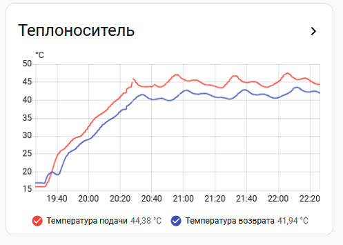
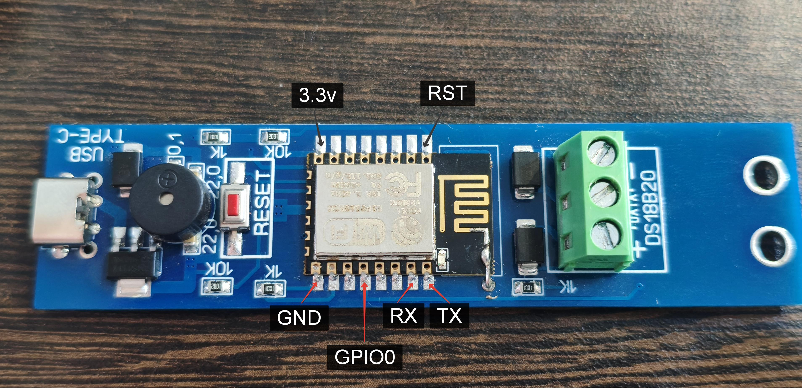
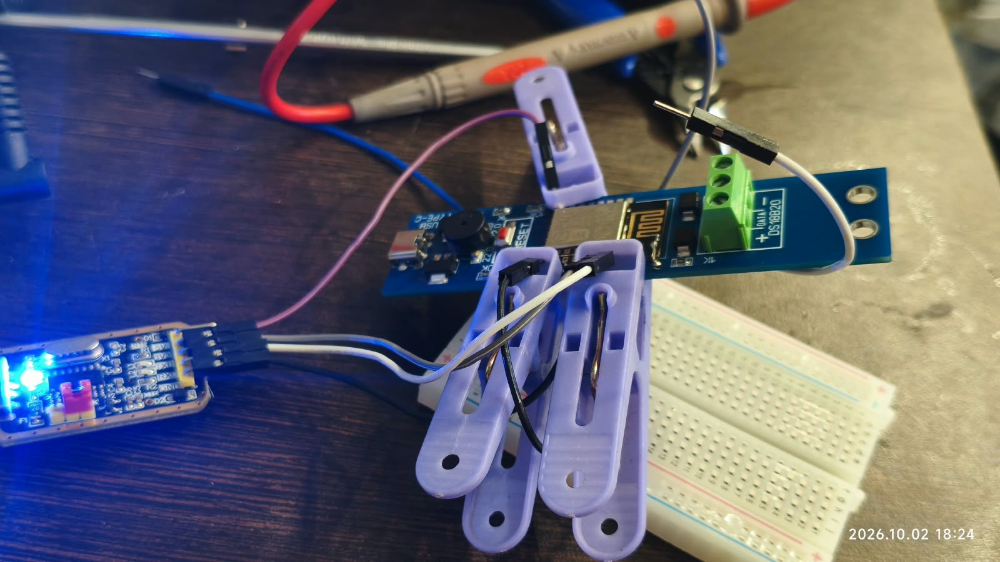

# Thermobot‑2 — ESPHome‑мониторинг температуры в Home Assistant

Конфигурации ESPHome для плат серии **Thermobot‑2** ([42unita.ru](https://www.42unita.ru)) под задачи контроля температур в отопительных системах. Проект ориентирован на *почти простое* развёртывание и гибкую настройку и состоит из двух устройств:

| | **Thermobot‑2 Mini** («HeatFlow») | **Thermobot‑2.2** («Boiler Monitor») |
|---|---|---|
| Назначение | контроль подачи и обратки в системе отопления | контроль котла на твёрдом топливе |
| Датчики | DS18B20 × 2 (подача, обратка) | DS18B20 × 5 (улица, подача, обратка, шнек, воздух в бункере) |
| Дисплей | нет | 3‑разрядный 7‑сегментный (TM1637) |
| Кнопка | опционально (GPIO14) | нет |
| Конфигурация | [heatflow.yaml](Thermobot‑2%20Mini/heatflow.yaml) | [boiler-monitor.yaml](Thermobot-2.2/boiler-monitor.yaml) |
| Адрес в сети | [heatflow.local](http://heatflow.local) | `boiler-monitor.local` |
| Статус | проверена автором на плате (ESPHome 2026.9.1); последние доработки проверьте при первой сборке | подготовлена, сборку и работу на плате нужно проверить |



*Рисунок. Пример графика проекта thermobot_hass@esphome*

## Общие возможности

Обе конфигурации написаны в одном стиле и имеют общую основу:

- **Измерение температуры** датчиками DS18B20 с **ручной калибровкой** каждого датчика (смещение в °C, меняется из Home Assistant или web‑интерфейса).
- **Сигнализация по температуре.** У каждого датчика свои минимальный и максимальный пороги. При выходе за пороги срабатывает повторяющийся звуковой сигнал на зуммере и мигает светодиод. Интервал повтора настраивается.
- **Подтверждение тревоги** кнопкой в Home Assistant (звук и светодиод гасятся, состояние тревоги сохраняется до возврата температуры в норму).
- **Отказ датчика** выводится отдельной сущностью, чтобы о нём можно было получить уведомление.
- **Индикация состояния** светодиодом, **оповещения** при загрузке и подключении к Wi‑Fi (звуковые и визуальные).
- **Зуммер** управляется программным ШИМ (PWM). Настраиваются громкость, частота и длительность сигнала, есть общий выключатель звука и кнопка пробного сигнала.
- **Wi‑Fi** с аварийной точкой доступа и порталом настройки, **web‑интерфейс** ESPHome с авторизацией, шифрованный **API** для Home Assistant, обновление по **OTA**, `safe_mode`.
- Все настройки (калибровки, пороги, звук) хранятся во flash и переживают отключение питания.

Требуется ESPHome 2026.9.1 или новее (рекомендуется 2026.10+).

---

## Thermobot‑2 Mini — «HeatFlow»

### Назначение

Измерение температуры подачи и обратки теплоносителя (датчики DS18B20), расчёт разности температур, сигнализация при выходе за пороги.

### Функции

- Температуры **Supply** (подача) и **Return** (обратка) с отдельной калибровкой и отдельными порогами тревоги.
- Дополнительная сущность **Delta temperature** (подача минус обратка) для диагностики системы.
- Общая тревога **Temperature alarm**, отказ датчика **Temperature sensor fault**.
- Кнопка **Acknowledge alarm** в Home Assistant и (опционально) физическая кнопка: короткое нажатие подтверждает тревогу.

### Подключение

| Пин | Назначение | Примечание |
|---|---|---|
| GPIO0 | линия 1‑Wire, датчики DS18B20 | strapping‑пин, подтяжка 4,7 кОм к 3,3 В |
| GPIO2 | светодиод | инверсная логика |
| GPIO12 | пассивный зуммер | программный ШИМ |
| GPIO14 | кнопка | опционально; если кнопки нет, соответствующий блок можно исключить из прошивки |

Количество датчиков опционально: датчики адресуются по уникальным адресам, нужные вписываются в YAML.

### Аппаратная часть

- **Плата:** Thermobot‑2 Mini с ESP8266MOD (4Mb).
- **Производитель:** [42unita.ru](https://www.42unita.ru).
- **Датчики:** DS18B20 (one‑wire). В оригинале от производителя смонтирован один, под проект без изменения схемы подключения параллельно добавлен ещё один. Адреса датчиков уникальные. Как их узнать, описано в разделе [Адреса датчиков DS18B20](#адреса-датчиков-ds18b20).
- **Индикатор:** светодиод с инверсной логикой, пискун.
- **Прошивка:** с адаптером USB‑UART на базе CH340G.



*Рисунок: Схема пинов для прошивки Thermobot‑2 Mini.*

---

## Thermobot‑2.2 — «Boiler Monitor»

> **Статус:** конфигурация подготовлена, но в ESPHome ещё не собиралась и на плате не проверялась. Проверьте её при первой сборке. Адреса датчиков в YAML сейчас заглушки, их нужно заменить.

### Назначение

Контроль котла на твёрдом топливе: пять точек измерения, местная индикация на семисегментном дисплее и сигнализация при выходе температур за пороги. Кнопок на устройстве нет, поэтому дисплей работает автоматически, а режим выбирается из Home Assistant или web‑интерфейса.

### Датчики

Все пять DS18B20 на одной шине 1‑Wire (GPIO0). У каждого своя калибровка (±10 °C) и свои пороги тревоги.

| Датчик | Что измеряет | Метка на дисплее | Пороги по умолчанию, °C |
|---|---|---|---|
| Outdoor | уличный воздух | `Out` | −55 … 125 (тревога выключена) |
| Supply | подача теплоносителя | `SUP` | 5 … 90 |
| Return | возврат теплоносителя | `rEt` | 5 … 90 |
| Auger | температура шнека | `Aug` | −55 … 60 |
| Hopper | воздух в бункере | `Hop` | −55 … 50 |

Пороги шнека и бункера это стартовые значения: задайте их по паспорту котла. Перегрев этих узлов может означать риск обратного прогара.

### Дисплей

Три разряда, драйвер TM1637. Режим отображения придуман с учётом того, что аппаратных кнопок нет:

- **Auto (по умолчанию):** карусель по всем датчикам. Каждая страница это метка датчика, затем его значение (например, `SUP` → `65.3`).
- **Фиксированный датчик:** `Outdoor` / `Supply` / `Return` / `Auger` / `Hopper`. Показывается только он, его метка периодически выводится на дисплей.
- **Тревога приоритетнее режима:** при выходе датчика за пороги дисплей показывает только датчики в тревоге, а их значение мигает. Это работает в любом режиме.
- Время страницы и яркость регулируются, при отказе датчика выводится `---` (первые секунды после загрузки) или `Err`.

Подробности и таблицы параметров: [boiler-monitor-description.md](Thermobot-2.2/boiler-monitor-description.md).

### Подключение

| Пин | Назначение | Примечание |
|---|---|---|
| GPIO0 | линия 1‑Wire, 5 датчиков DS18B20 | strapping‑пин, подтяжка 4,7 кОм к 3,3 В обязательна |
| GPIO2 | светодиод | инверсная логика |
| GPIO4 | TM1637, CLK | |
| GPIO5 | TM1637, DIO | |
| GPIO12 | пассивный зуммер | программный ШИМ |

Распиновка соответствует конфигурации оборудования из [thermobot.yaml](thermobot.yaml). GPIO14 (кнопка) не используется.

### Аппаратная часть

- **Датчики:** 5 × DS18B20, у каждого свой адрес. Все подключаются параллельно к одной линии GPIO0.
- **Дисплей:** 3‑разрядный семисегментный модуль на TM1637. Если цифры идут в обратном порядке или модуль установлен «вверх ногами», в конфигурации есть параметр `display_inverted`.
- **Индикаторы:** светодиод с инверсной логикой, пассивный зуммер.

---

## Программная часть

- **Создание прошивки** ESPHome для ESP8266MOD (4Mb) осуществляется с помощью файла конфигурации нужного устройства: [heatflow.yaml](Thermobot‑2%20Mini/heatflow.yaml) для Thermobot‑2 Mini или [boller-monitor.yaml](Thermobot-2.2/boller-monitor.yaml) для Thermobot‑2.2. Результат сборки это скомпилированный firmware.bin.
- **Прошивка проекта** локально с помощью esptool через адаптер USB‑UART.
- **Web‑интерфейс** доступен в новой прошивке по адресу mDNS в локальной сети (`heatflow.local` или `boiler-monitor.local`), либо по IP.
- **Home Assistant** получит новое устройство через стандартную интеграцию ESPHome.

## Прошивка (случай автора)

Процедура описана для Thermobot‑2 Mini. Для Thermobot‑2.2 она такая же, если на плате есть те же выводы UART, GPIO0 и RST (сверьтесь со схемой платы).



*Рисунок: Подключение Thermobot‑2 Mini локально через адаптер USB‑UART для первой прошивки*

Команда для прошивки ESP8266 в командной строке Windows:

```CLI
(venv) C:\esp\...\venv\Scripts>esptool --chip esp8266 --port COM4 --baud 115200 write-flash --flash-mode qio --flash-size 4MB 0x00000 firmware.bin
```

**Важные моменты:**
- usb type-c для прошивки **не используется!**, порт использовать только для питания прошитого устройства;
- плату к USB‑UART подключать по питанию 3,3В;
- для входа в режим прошивки: при подключении платы *заземлить* GND к GPIO0, потом GND к RST, *отключить* GND от RST, потом GND от GPIO0;
- заменить COM4 на актуальный COM‑порт вашего устройства;
- файл firmware.bin должен находиться в текущей рабочей директории esptool, либо использовать venv, либо полный путь к файлу;
- вариантов способов прошивки несколько, приведён тот, который точно работает у автора.

Вывод после успешной прошивки:

```
esptool v5.3.1
Connected to ESP8266 on COM4:
Chip type:          ESP8266EX
Features:           Wi-Fi, 160MHz
Crystal frequency:  26MHz
MAC:                48:fa:2f:6d:2c:36

Stub flasher is already running. No upload is necessary.

Configuring flash size...
Flash parameters set to 0x0040.
Flash will be erased from 0x00000000 to 0x00072fff...
Wrote 467792 bytes (339484 compressed) at 0x00000000 in 30.6 seconds (122.5 kbit/s).
Hash of data verified.

Hard resetting via RTS pin...
```

## Настройка

### Секреты

Скопируйте `secrets.example.yaml` в `secrets.yaml` и заполните значения (одни и те же ключи используются в обеих конфигурациях):

```yaml
wifi_0f: "ssid_вашей_сети_2.4GHz"
wifi_password: "пароль_вашей_сети_2.4GHz"
web_server_pass: "пароль_для_веб_интерфейса"
api_key: "api_ключ_для_home_assistant"
```

`secrets.yaml` исключён в корневом `.gitignore` и не должен попадать в git.

### Адреса датчиков DS18B20

Адреса датчиков уникальные, и актуальные можно узнать из логов устройства в ESPHome:

1. Первоначально укажите в YAML адрес‑заглушку (например, `0x0000000000000000`) и временно поставьте `logger: level: DEBUG`.
2. Прошейте устройство и найдите адреса подключённых датчиков в логе. Для нескольких датчиков подключайте их **по одному**, чтобы знать, какой адрес чей.
3. Впишите актуальные адреса в подстановки (`addr_supply`, `addr_return`; для Thermobot‑2.2 ещё `addr_outdoor`, `addr_auger`, `addr_hopper`) и верните `level: WARN`.

В конфигурации Thermobot‑2.2 пять отдельных адресов обязательны, так как датчики работают на одной шине.

### Настройка в Home Assistant

- Устройство добавится через интеграцию ESPHome (обнаруживается автоматически, при запросе введите `api_key`).
- Калибровки, пороги, звук и (для Thermobot‑2.2) режим дисплея доступны как сущности устройства.
- Для Thermobot‑2.2 подготовлены карточка панели [boiler-monitor-lovelace.yaml](Thermobot-2.2/boiler-monitor-lovelace.yaml) и автоматизация уведомления о тревоге [boiler-monitor-automation.yaml](Thermobot-2.2/boiler-monitor-automation.yaml). Порядок подключения описан в [boiler-monitor-description.md](Thermobot-2.2/boiler-monitor-description.md).

## Развитие проекта

Для сведения привожу yaml прошивки после реверс‑инжиниринга оригинального дампа (автором не тестировалась, но соответствует по GPIO): [thermobot-ds.yaml](Thermobot‑2%20Mini/thermobot-ds.yaml). Он же служит источником распиновки для Thermobot‑2.2.

### Обновление прошивки

Используйте интерфейсы ESPHome API или web по адресу mDNS в локальной сети: [heatflow.local](http://heatflow.local) или [boiler-monitor](http://boiler-monitor.local), либо по IP.
